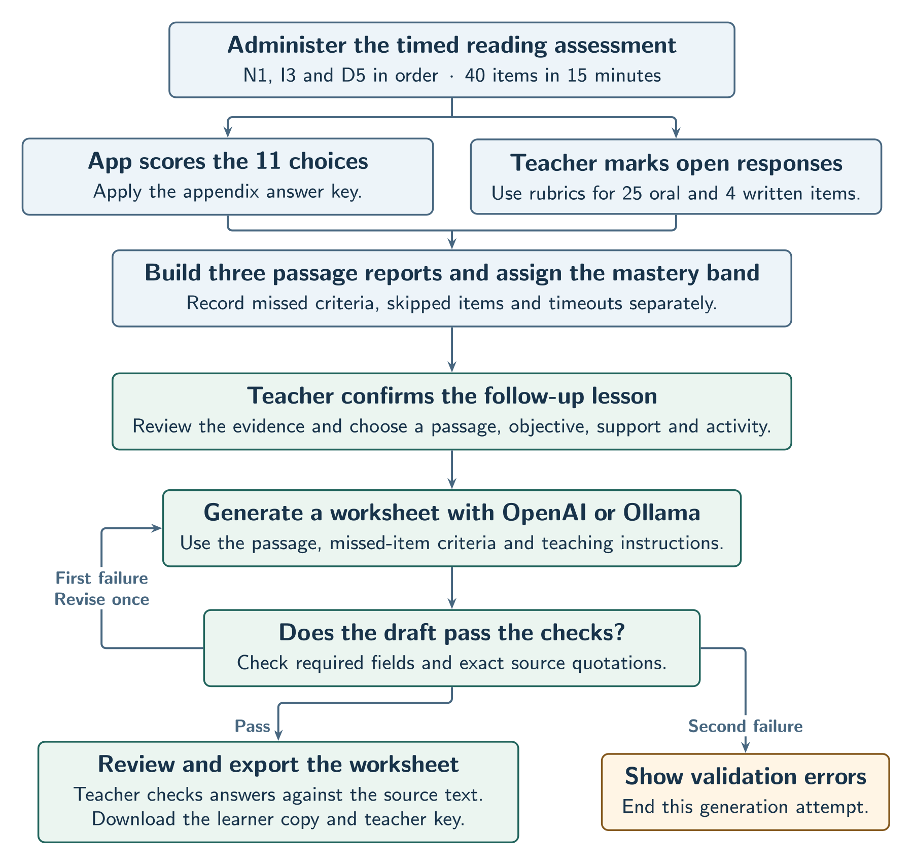

# Reading Worksheet Studio

A teacher can administer the Group 5 reading assessment, score the learner’s responses, and use the missed items to plan a worksheet on another passage. The assessment and marking run locally. Worksheet generation uses OpenAI or a local Ollama model.

The worked demo follows a scripted 37/40 attempt. Two answers reverse the order of events, so the teacher uses a fresh story to practise sequencing. The walkthrough includes the item rubrics, passage scores, learner worksheet and teacher key. [Read the demo](Worksheet_Demo.md)

## Workflow



The diagram shows where the teacher reviews evidence and where the app checks the generated draft. [LaTeX/TikZ source](figures/workflow.tex)

## Run the app

From this folder, use Python 3.11 or 3.12 to install the dependencies and start Streamlit.

```bash
python3 -m venv .venv
source .venv/bin/activate
python -m pip install -r requirements.txt
python -m streamlit run app.py --server.address 127.0.0.1
```

Open the local URL printed in the terminal. The app starts in **Reading assessment**. An API key is optional until you choose hosted worksheet generation.

## Administer and mark the assessment

Start the timer when the learner is ready. The three parts share 15 minutes, with a five-minute target per passage. Record choices, transcribe spoken answers and enter written responses. Each item can also be explicitly skipped.

| Part | Passage | Items |
| --- | --- | ---: |
| 1 · Narrative | N1 · The Red Ball | 13 |
| 2 · Informational | I3 · Where Rain Comes From | 13 |
| 3 · Narrative with dialogue | D5 · The Last Train Home | 14 |

After submission or timeout, open **Teacher marking**. The app marks the 11 choices automatically. Use the criterion beside each of the 25 oral and four written items to award 0 or 1 for each answer. For example, N1.1 accepts either “Tim” or “the boy.” Skips and timeouts contribute no points and are counted separately from answered items that missed their criterion.

**Score assessment** produces three passage reports and a combined score. Appendix B assigns full mastery at 35–40 points, basic proficiency at 30–34, partial mastery at 25–29, significant difficulty at 20–24 and lack of mastery at 0–19. **Review marks again** lets you correct a mark while the answers stay locked. Download the reports before closing or resetting the session.

## Create a worksheet

1. Select **Create worksheet from this assessment**. Choose an appendix passage and enter a lesson objective. You can also specify vocabulary, letter–sound patterns, previously taught skills, length or presentation preferences.
2. Review the missed items, quoted evidence and suggested teaching support. Missed sequencing or passive-voice tasks across two passages trigger targeted practice. Edit the support, choose a teaching activity and confirm the profile and objective.
3. Select a provider and **Generate worksheet**. For OpenAI, enter your key or set `OPENAI_API_KEY`. For Ollama, start the local server and select a downloaded model. The request contains the selected passage, missed-item specifications and teaching instructions. The learner’s answers, score and full report stay in the session.
4. Review the draft and download the learner copy. Select **Show teacher notes and answer key** for the teacher copy. Python checks that each answer has a quotation from the original passage and allows one repair attempt for invalid output. The teacher checks that each quotation supports the answer.

## Reproduce the demo and compare prompts

Run `python3 demo.py` to print the walkthrough without a model, or `python3 demo.py > Worksheet_Demo.md` to regenerate the Markdown. The score comes from the production scorer. The script includes a prewritten worksheet and runs it through the same checks and Markdown export as an app draft.

Run `python3 compare.py` for an offline preview of the two worksheet requests. Both use the same N2 passage, lesson objective, worksheet prompt and validation. The assessment-informed request also includes the two missed items and their suggested support. To generate both drafts and a reviewer scoring table with a local model, run the following command with a model installed in Ollama.

```bash
python3 compare.py --run --backend Ollama --model gemma3:4b > comparison.md
```

## Course data and verification

The two UTF-8 tables join on `passage_id`. They contain all 15 passages and 200 questions, including the 12 reserve passages. [Passages](data/passages.csv) · [Questions, keys and rubrics](data/questions.csv)

To rebuild the tables, run `python3 export_bank.py`. The exporter reads the metadata table in `INFH5000_Group5_Reading_Materials.docx` and the passage and question tables in `INFH5000_Group5_Test_Items.docx` from the parent project folder. For another location, pass `--source-dir PATH`.

With the virtual environment active, run `python -m unittest -v` to check scoring boundaries, timed entry, teacher marking, worksheet generation with a test client, and the saved demo.
